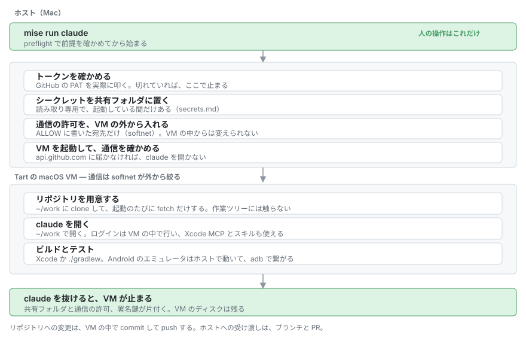
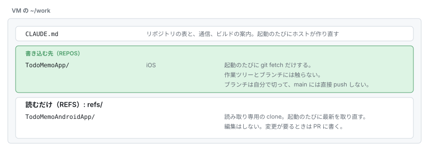
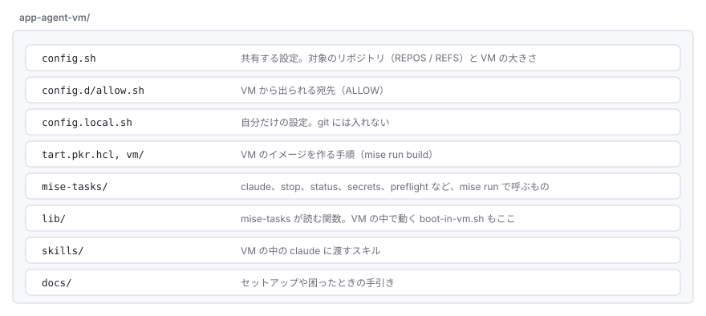

# app-agent-vm

Claude Code を、Mac の中の別の macOS（VM）で動かすための環境。
`mise run start` で VM を立ち上げておいて、`mise run claude` でその中に入る。
VM は止めるまで動き続けるので、ターミナルをいくつも開いて、会話を同時に走らせられる。
抜けた会話は、あとから ID で再開できる。



VM には [Tart](https://github.com/openai/tart) を使っている。
Xcode が最初から入っているので、ビルドをホストに橋渡しする必要がない。

VM から外に出られるのは、`config.d/allow.sh` に書いた宛先だけ。
この制限は VM の外側で効かせているので、VM の中で root を取っても抜けられない。

Android のエミュレータだけは VM の中で動かない。
ホストで動かして、`mise run start` が VM に繋ぐ。
その通信も `pf` で絞っている。

最初に一度だけ[セットアップ](docs/instructions/setup.md)が要る。

## 使い方

```bash
mise run build            # VM のイメージを作る（最初の一回）
mise run start            # VM を起動して置いておく。このターミナルは開けたままにする
mise run claude           # 別のターミナルで。VM の中で新しい会話を始める
mise run claude <ID>      # 前の会話を再開する
mise run claude --repo <名前>   # 作業ツリーを切って、新しい会話を始める
mise run status           # 何が動いているか見る
mise run stop             # 別のターミナルから止める（start のターミナルで Ctrl-C でもいい）
```

`mise run claude` は、ターミナルを分ければ何本でも開ける。
会話の ID の調べ方や、作業ツリーの扱いは[会話の再開と並行作業](docs/instructions/sessions.md)に書いた。
claude の引数は `--` のあとに書く（`mise run claude -- --model opus`）。

VM を止めても、ディスクは残る。
clone したリポジトリ、Claude のログイン、会話の履歴は、次に起動したときも使える。

Claude のログインは VM の中でやる。
初回と、期限が切れたときだけ、claude が出す手順に従えばいい。
Claude の認証情報は、ホストのキーチェーンには入れていない。

## 触るリポジトリ

`config.sh` の `REPOS` が書き込む先で、`REFS` が読むだけの先。
VM の `~/work/<名前>` と `~/work/refs/<名前>` に clone して、起動のたびに fetch だけする。
作業ツリーやブランチには触らないので、途中の変更が消えることはない。

`mise run claude` は、何も付けなければ `~/work` で開く。
そこに置く `CLAUDE.md` には、リポジトリの表と、通信の制限、ビルドの方法が書いてある。
この表は `config.sh` から毎回作り直す。



増やしたいときは `config.local.sh` に `REPOS+=("owner/repo")` と書く。

claude は `--dangerously-skip-permissions` 付きで開く（`config.sh` の `CLAUDE_ARGS`）。
通信を絞った VM の中だけで動かす前提で、確認のたびに止まらないようにしている。
ただし、VM の中には PAT を渡してあるので、claude は対象のリポジトリに push できてしまう。
PAT の範囲を必要なリポジトリだけに絞っておくこと（[シークレット](docs/instructions/secrets.md)）。

確認を残したければ、`config.local.sh` に `CLAUDE_ARGS=()` と書く。

## 設定

共有したい設定は `config.sh` と `config.d/`、自分だけの設定は `config.local.sh`（git に入れない）。
どちらにもシークレットは書かない。
シークレットはキーチェーンに入れる。

## VM に入っているもの

ベースイメージ（`config.sh` の `BASE_IMAGE`）に、Xcode、Simulator のランタイム、brew、node、gh、mise、git、Claude Code が入っている。
Packer が足すのは Xcode MCP をヘッドレスで使うための設定だけ（`vm/mise.toml`）。

Claude Code を上げたいときは、VM の中で `brew upgrade --cask claude-code` を実行する。

## Xcode のスキル

`skills/device-interaction/` は Xcode が同梱しているスキルで、Apple のものなのでこのリポジトリには入れていない（`.gitignore` してある）。
使うなら、自分の環境で書き出して `skills/` に置く。

```bash
d=$(mktemp -d) && xcrun agent skills export --output-dir $d && cp -R $d/device-interaction skills/
```

置いてあれば、起動のときに VM に渡る。
無くても、ほかのスキルは動く。

## 作り直しと容量

`mise run build` は、同じ名前の VM があると止まる。
作り直すと VM の中のものが全部消えるので、消すかどうかは自分で決めて、`tart delete <VM 名>` してからもう一度走らせる。
残したいもの（`~/work` の途中の変更など）は先に取り出しておく。

VM は 100GB 近く、ベースイメージは 75GB ほどある。
200GB くらい空けておくと安心。

## ほかの構成との関係

JIRA のチケットから自動で回す構成（Symphony を使うもの）から、その部分を外して作った。
Android の `pf` の anchor（`acvemu`）とグループは、その構成と共有している。
両方で同時にエミュレータを使うと、お互いの規則を消し合うので、同時には動かさないこと。

## どこに何があるか



## もっと詳しく

| | |
|---|---|
| [セットアップ](docs/instructions/setup.md) | 最初の一回 |
| [会話の再開と並行作業](docs/instructions/sessions.md) | ID で再開する。`--repo` で作業ツリーを切る |
| [シークレット](docs/instructions/secrets.md) | キーチェーンから VM へ渡す方法 |
| [通信の制限](docs/instructions/network.md) | softnet と `ALLOW` |
| [Android のエミュレータ](docs/instructions/android.md) | ホストで動かして VM から繋ぐ |
| [困ったとき](docs/instructions/troubleshooting.md) | 症状から探す |
