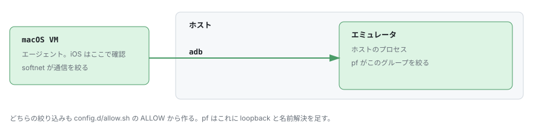

# Android のエミュレータ



エミュレータはホストで動かして、VM からは adb で繋ぐ。
起動も後片付けも、`mise run claude` がやる。

## 最初に一回だけ

エージェント用の AVD を、自分が使っているものとは別に作る。
Android Studio の画面から作ればいい。

| | |
|---|---|
| システムイメージ | `google_apis` の `arm64-v8a` |
| 名前 | 自分用と見分けがつくもの |

作った名前を `config.local.sh` に書く。
ここに書いた AVD だけが VM に渡る。

```bash
ANDROID_AVDS=("Pixel_10_Pro" "Pixel_Tablet")
```

タブレットや折りたたみでも確かめたければ、並べて書く。

アプリが繋ぎに行く先は、`config.d/allow.sh` の `ALLOW` に足す。
エミュレータの通信も、この一覧で絞られる。

VM を止めた状態で、グループと `pf` の設定を入れる。

```bash
mise run android-user
```

## 使うとき

特にやることはない。
`mise run claude` が `ANDROID_AVDS` の AVD を起動して、通信を絞って、トンネルを張る。
切れたら張り直す。

VM の中では、`adb devices` に `device` として出てくる。
`adb connect` は要らない。
撮った画像は VM の側に落ちるので、そのまま PR に貼れる。

トンネルのログは `$TMPDIR/_acvemu.log` に出る。

トンネルを手で張り直したいときは、ssh を落とせばいい。
5 秒ほどで繋ぎ直す。

```bash
pkill -f "^ssh -i .*/adb-tunnel "
```
