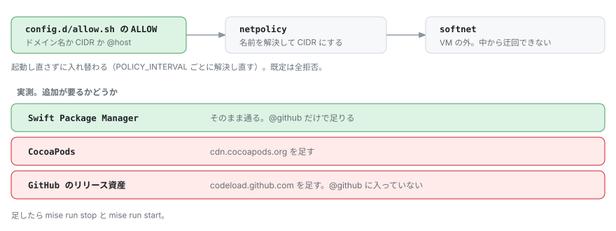
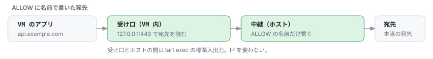

# 通信の制限

VM から出られるのは、`config.d/allow.sh` の `ALLOW` に書いた宛先だけ。
制限は softnet が VM の外で効かせているので、VM の中で root を取っても迂回できない。

```bash
ALLOW=(
  "@host"                   # ブリッジのゲートウェイ。名前解決に要る
  "@github"                 # 公開レンジを api.github.com/meta から取る
  "uploads.github.com"      # PR への添付。@github には含まれない
  "17.0.0.0/8"              # Apple。CIDR はそのまま通る
)
```

初期状態は全部拒否で、tart の `--net-softnet-block 0.0.0.0/0` がそれを持っている。
許可を入れるよりも先にこれが効くので、入れるのに失敗しても開きっぱなしにはならない。
許可は制御チャネルから入れていて、`mise-tasks/netpolicy` が `POLICY_INTERVAL` ごとに名前を引き直す。
宛先の IP が変わっても、VM を起動し直さなくていい。

`ALLOW` に `0.0.0.0/0` を書くと全部通ってしまう。
`mise run test` と起動のときに弾いている。

起動のたびに `api.github.com` に届くかだけ確かめて、届かなければ start が止まる。
ほかの宛先は確かめない。

## 宛先を足す



`config.d/allow.sh` の `ALLOW` に足して、`mise run stop` のあとで `mise run start` をやり直す。

```bash
ALLOW+=("cdn.cocoapods.org")
```

自分だけで使うものは `config.local.sh` に書く。

ワイルドカードは書けない。
名前は `dig` で引いているので、`*.example.com` には A レコードがないため。
まとめて開けたいときは、CIDR で書く。

宛先が分かっているなら、VM の中から叩いて確かめられる。

```bash
tart exec <VM 名> curl -s -o /dev/null -m 8 -w '%{http_code}\n' https://<宛先>/
```

`000` なら届いていない。

## 名前と CIDR の違い



| `ALLOW` の書き方 | 通り方 |
|---|---|
| 名前（`api.github.com`） | ホストが代わりに繋ぐ。443 の HTTPS だけ |
| `@host`、`@github`、CIDR | softnet が通す。VPN をつなぐと通らなくなる |

名前の宛先は、VM の中では 127.0.0.1 に向く。
そこにある受け口が TLS の宛先（SNI）を読んで、`tart exec` の標準入出力でホストに渡す。
実際に繋ぐのはホストなので、ホストの `ALLOW` にある名前しか通らないし、VM の中から書き換えることもできない。

注意しておくこと。

- 443 以外のポートや、HTTPS 以外は、名前では通らない。CIDR で書く
- 依存の取得先は、リダイレクト先まで書く。たとえば Gradle の配布物は、`github.com` から `release-assets.githubusercontent.com` に飛ぶ
- 繋げなかったときのエラーは、`mise run start` の出力に出る

## VPN をつないだとき

VPN をつないでいる間は、IP で書いた宛先（`@github`、`17.0.0.0/8`、CIDR）が VM から通らなくなる。
名前で書いた宛先は通る。

| 宛先の書き方 | VPN をつないだ間 |
|---|---|
| 名前 | 届く。ただ、つないだ瞬間に、つながっていた接続が 1 つ切れる |
| `@github`、`17.0.0.0/8`、CIDR | 届かない。切ると 30 秒ほどで戻る |

分かっていることと、分かっていないこと。

- 名前はホストが接続のたびに引いて繋ぐので、VPN で DNS や経路が変わっても、次の接続から追いつく
- IP の宛先が止まるのは、引き直し（`POLICY_INTERVAL`）が遅れているからではなさそう。8 分待っても戻らなくて、切ると引き直しよりも早く戻った
- 原因は、VM から出ていく直接の通信が VPN の経路に乗れないことだと思っているが、確かめてはいない
- VPN をつないだまま使いたい宛先は、名前で書く。ただし中継は 443 の HTTPS だけなので、ほかのポートは VPN の間は通せない
- `git fetch` や `pod install` のような長い通信は、つないだ瞬間に失敗することがある。やり直せば通る
- エミュレータの絞り込み（`pf`）は、つないでも切っても外れなかった。外れたら `mise run status` に出る

Cisco で一回測っただけなので、ほかの VPN は分からない。

## どこで止まっているか調べる

softnet は、遮断したことを記録してくれない。
落ちた側のエラーから辿るしかない。

エラーに宛先が書いてあることが多い。
CocoaPods なら、`CDN: trunk URL couldn't be downloaded: https://cdn.cocoapods.org/... Timeout was reached` のように出る。

書いていなければ、VM が引いた名前を出してみる。
遮断されても、名前を引くところまでは通るので、これで分かる。

```bash
mise run lookups        # 既定は 30 秒。引数で変えられる
```

流している間に、詰まる操作をもう一度やる。
一度引いた名前はキャッシュされて出てこないので、間を空けるか、別の名前で試す。
