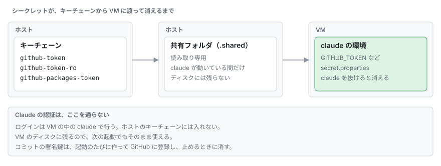
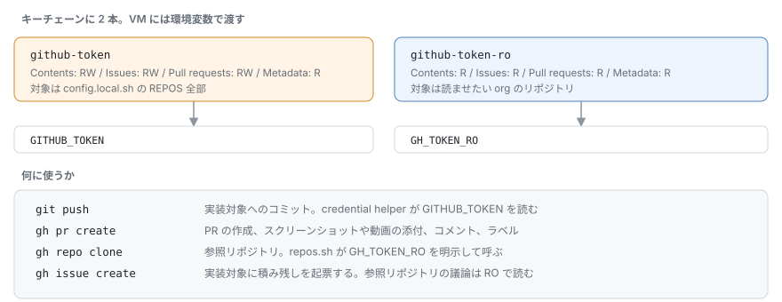
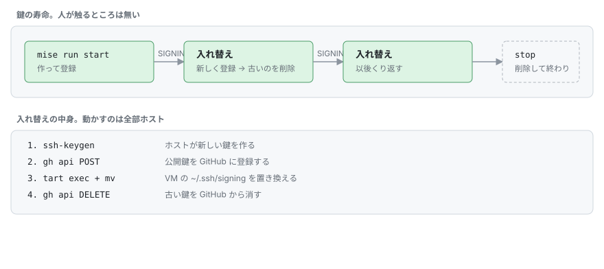

# シークレット

リポジトリにも、VM のイメージにも、シークレットは入れない。
ホストのキーチェーンに入れておいて、起動のたびに VM に渡す。
VM が止まれば、渡したものも消える。



キーチェーンのサービス名は `VM_NAME` と同じなので、VM を分ければシークレットも分かれる。

```bash
mise run secrets
```

環境変数があれば、そちらが優先される。
名前は、キーの名前に `AAV_` を付けて大文字にし、`-` を `_` にしたもの。

```bash
AAV_GITHUB_TOKEN=... mise run start
```

画面のない環境（SSH で入ったセッションなど）では、キーチェーンが施錠されたままで読めない。
そういうときは、この環境変数を使う。

| キー | 中身 |
|---|---|
| `github-token` | 書き込み用の PAT。`REPOS` に Contents と Pull requests の Read and write |
| `github-token-ro` | 読み取り用の PAT。`REFS` に Contents の Read-only。`REFS` が空でなければ必須 |
| `github-packages-token` | 必要なときだけ。GitHub Packages から取るビルド用（[下](#github-packages-の-pat)） |

Claude の認証はここには入れない。
VM の中の claude でログインする。

`gh auth token` の出力は渡さないこと。
`gho_` で始まるものは、権限が広すぎるので起動時に弾く。

## 1 つだけ更新する

クリップボードにコピーした値を、そのまま渡すのが楽。

```bash
security add-generic-password -U -s app-agent-vm -a github-token -w "$(pbpaste)" && pbcopy < /dev/null
```

`VM_NAME` を変えているなら、`-s` もそれに合わせる。
最後の `pbcopy` はクリップボードを空にするためのもの。

`-w` だけで値を聞かせる書き方は使わない。
入力が 128 文字で切れることがあって、長いトークンが壊れる。

## PAT の作り方

[personal-access-tokens/new](https://github.com/settings/personal-access-tokens/new) で作る。



| | 書き込み用 | 読み取り用 |
|---|---|---|
| Repository access | `REPOS` 全部 | `REFS` のリポジトリ |
| Contents | Read and write | Read |
| Pull requests | Read and write | Read |
| Issues | Read and write | Read |
| Metadata | Read | Read |

Issues は、積み残しを起票させたいときだけ。
いらなければ外していい。

範囲の外のリポジトリは、403 ではなく 404 が返ってくる。
「権限がない」ではなく「存在しない」に見えるので、届かないときはまず対象に入っているかを疑う。

PAT には有効期限があって、切れると 401 になる。
起動のときに GitHub を実際に叩いて確かめて、切れていれば VM を起動しない。

## GitHub Packages の PAT

ビルドが GitHub Packages（`maven.pkg.github.com`）から取ってくるときだけ要る。
使わなければ空のままでいい。
使うなら、`maven.pkg.github.com` と `github-registry-files.githubusercontent.com` を `ALLOW` に足す。

[tokens/new](https://github.com/settings/tokens/new) で classic の PAT を作る。
GitHub Packages は、classic の PAT しか受け付けない。
スコープは `read:packages` だけにして、有効期限も付ける。

組織のパッケージを読むなら、トークンの横の Configure SSO で、その組織を Authorize する。

この PAT は、そのアカウントが読める全部のパッケージを読めてしまう。
リポジトリ単位には絞れない。

`mise run secrets` の最後に聞かれる。
環境変数なら `AAV_GITHUB_PACKAGES_TOKEN`。

VM の中では、リポジトリに `secret.properties.template` があれば、そこから `secret.properties` を作って `gpr.user` と `gpr.key` を入れる。
`gpr.user` は、書き込み用の PAT の持ち主。

## コミットの署名



起動のたびに ed25519 の鍵を 1 本作って、公開鍵を Signing Key として GitHub に登録し、止めるときに消す。
`SIGNING_ROTATE_SECONDS` ごとに、動いている間も入れ替える。
漏れても、使えるのはその時間だけ。

登録も削除もホストの `gh` がやるので、VM は GitHub のアカウント設定に触れない。
VM に渡るのは、秘密鍵のファイルだけ。

この権限は一回だけ足しておく。
足さなくても動くが、コミットが署名なしになる。

```bash
gh auth refresh -h github.com -s admin:ssh_signing_key
```
